# DBH–Height Models

DBH–height (`hd_*()`) models predict **total tree height (m)** from
diameter at breast height (DBH, cm, measured at 1.3 m). They are
typically used to fill in heights of trees that were not measured,
before applying a volume or biomass model that requires height.

Many published DBH–height models need more than DBH: stand-level
predictors such as basal area, stems per hectare or dominant height,
climate normals, or ecological classification codes. Each source also
defines these predictors differently (size thresholds, all-species vs
species-specific totals, dominant-height definitions). For this reason:

- each model is a separate function whose arguments are exactly the
  predictors that model uses;
- you choose the model, and a missing required predictor is an error,
  never replaced by a proxy;
- a registry and two helper functions let you find which models suit
  your data, and what each predictor means in the source publication;
- for convenience,
  [`hd()`](https://ptompalski.github.io/CanadaForestAllometry/reference/hd.md)
  selects a model automatically per tree (like
  [`vol()`](https://ptompalski.github.io/CanadaForestAllometry/reference/vol.md));
  see [Automatic model selection](#hd-auto).

## DBH–height models included in the package

- [`hd_auger2016()`](https://ptompalski.github.io/CanadaForestAllometry/reference/hd_auger2016.md)
  ([Auger, 2016](#ref-Auger2016)). Coverage: QC, natural stands. 27
  species. Model ID(s): `auger2016`.
- [`hd_auger2025()`](https://ptompalski.github.io/CanadaForestAllometry/reference/hd_auger2025.md)
  ([Auger et al., 2025](#ref-Auger2025)). Coverage: QC, plantations. 2
  species. Model ID(s): `auger2025_dbh`, `auger2025_plot_mean_dbh`,
  `auger2025_dominant`.
- [`hd_eslamdoust2026()`](https://ptompalski.github.io/CanadaForestAllometry/reference/hd_eslamdoust2026.md)
  ([Eslamdoust et al., 2026](#ref-Eslamdoust2026)). Coverage: ON,
  natural stands. 8 species. Model ID(s): `eslamdoust2026_m4`,
  `eslamdoust2026_m5`.
- [`hd_eslamdoust2026b()`](https://ptompalski.github.io/CanadaForestAllometry/reference/hd_eslamdoust2026b.md)
  ([Eslamdoust, 2026](#ref-Eslamdoust2026b)). Coverage: ON, plantations.
  1 species. Model ID(s): `eslamdoust2026b`.
- [`hd_fortin2009()`](https://ptompalski.github.io/CanadaForestAllometry/reference/hd_fortin2009.md)
  ([Fortin et al., 2009](#ref-Fortin2009)). Coverage: QC, natural
  stands. 20 species. Model ID(s): `fortin2009`.
- [`hd_huang1994()`](https://ptompalski.github.io/CanadaForestAllometry/reference/hd_huang1994.md)
  ([Huang et al., 1994](#ref-Huang1994hd)). Coverage: AB, natural
  stands. 12 species. Model ID(s): `huang1994`.
- [`hd_huang2009()`](https://ptompalski.github.io/CanadaForestAllometry/reference/hd_huang2009.md)
  ([Huang et al., 2009](#ref-Huang2009hd)). Coverage: AB, natural
  stands. 1 species. Model ID(s): `huang2009_m9`, `huang2009_m10`,
  `huang2009_m11`.
- [`hd_huang2016()`](https://ptompalski.github.io/CanadaForestAllometry/reference/hd_huang2016.md)
  ([Huang et al., 2016](#ref-Huang2016hd)). Coverage: AB, natural
  stands. 16 species. Model ID(s): `huang2016`.
- [`hd_huang2016b()`](https://ptompalski.github.io/CanadaForestAllometry/reference/hd_huang2016b.md)
  ([Huang and Yang, 2016](#ref-Huang2016hdExpanded)). Coverage: AB,
  natural stands. 14 species. Model ID(s): `huang2016b`.
- [`hd_rijal2012()`](https://ptompalski.github.io/CanadaForestAllometry/reference/hd_rijal2012.md)
  ([Rijal et al., 2012](#ref-Rijal2012)). Coverage: NB, NS, PE, QC,
  natural stands. 15 species. Model ID(s): `rijal2012_gnls`,
  `rijal2012_nlme`.
- [`hd_sharma2016()`](https://ptompalski.github.io/CanadaForestAllometry/reference/hd_sharma2016.md)
  ([Sharma, 2016](#ref-Sharma2016)). Coverage: ON, natural stands and
  plantations. 4 species. Model ID(s): `sharma2016_natural`,
  `sharma2016_plantation`.
- [`hd_sharmaparton2007()`](https://ptompalski.github.io/CanadaForestAllometry/reference/hd_sharmaparton2007.md)
  ([Sharma and Parton, 2007](#ref-SharmaParton2007)). Coverage: ON,
  natural stands and plantations. 8 species. Model ID(s):
  `sharmaparton2007`.
- [`hd_sharmazhang2004()`](https://ptompalski.github.io/CanadaForestAllometry/reference/hd_sharmazhang2004.md)
  ([Sharma and Zhang, 2004](#ref-SharmaZhang2004)). Coverage: ON,
  natural stands and plantations. 2 species. Model ID(s):
  `sharmazhang2004_eq2`, `sharmazhang2004_eq5`.
- [`hd_staudhammerlemay2000()`](https://ptompalski.github.io/CanadaForestAllometry/reference/hd_staudhammerlemay2000.md)
  ([Staudhammer and LeMay, 2000](#ref-StaudhammerLeMay2000)). Coverage:
  BC, natural stands and plantations. 4 species. Model ID(s):
  `staudhammerlemay2000_dbh`, `staudhammerlemay2000_density`.
- [`hd_temesgen2004()`](https://ptompalski.github.io/CanadaForestAllometry/reference/hd_temesgen2004.md)
  ([Temesgen and Gadow, 2004](#ref-Temesgen2004)). Coverage: BC, natural
  stands. 10 species. Model ID(s): `temesgen2004_m2`, `temesgen2004_m7`.
- [`hd_zhang2002()`](https://ptompalski.github.io/CanadaForestAllometry/reference/hd_zhang2002.md)
  ([Zhang et al., 2002](#ref-Zhang2002hd)). Coverage: ON, natural stands
  and plantations. 1 species. Model ID(s): `zhang2002_ecoregion`,
  `zhang2002_regional`, `zhang2002_overall`.

## Finding a model for your data

[`find_hd_models()`](https://ptompalski.github.io/CanadaForestAllometry/reference/find_hd_models.md)
filters the registry by jurisdiction and species, and reports which
required predictors each candidate lacks. Models with missing predictors
are kept as “near misses”, so you can see what extra data would make
them usable:

``` r

find_hd_models(
  jurisdiction = "ON",
  species = "PICE.MAR",
  available = c("DBH", "BA", "TPH")
) |>
  dplyr::select(model_id, usable, missing_predictors)
#> # A tibble: 5 × 3
#>   model_id              usable missing_predictors
#>   <chr>                 <lgl>  <list>            
#> 1 sharmazhang2004_eq2   TRUE   <chr [0]>         
#> 2 sharmazhang2004_eq5   TRUE   <chr [0]>         
#> 3 sharmaparton2007      FALSE  <chr [1]>         
#> 4 sharma2016_natural    FALSE  <chr [1]>         
#> 5 sharma2016_plantation FALSE  <chr [1]>
```

[`hd_model_registry()`](https://ptompalski.github.io/CanadaForestAllometry/reference/hd_model_registry.md)
returns the full metadata table, and
[`get_hd_model_info()`](https://ptompalski.github.io/CanadaForestAllometry/reference/get_hd_model_info.md)
returns one model’s species coverage and the source definition of each
predictor:

``` r

get_hd_model_info("sharmaparton2007")$predictors
#> # A tibble: 4 × 6
#>   arg   level units    required definition                        source_locator
#>   <chr> <chr> <chr>    <lgl>    <chr>                             <chr>         
#> 1 DBH   tree  cm       TRUE     D = diameter at breast height (D… FEM 249:187-1…
#> 2 HDOM  plot  m        TRUE     Dominant stand height (SHT): mea… FEM 249:187-1…
#> 3 BA    plot  m2/ha    TRUE     Total tree basal area (BA/ha); m… FEM 249:187-1…
#> 4 TPH   plot  stems/ha TRUE     Number of stems (N/ha), calculat… FEM 249:187-1…
```

## Predictors

Predictor arguments follow a shared vocabulary (upper-case acronyms,
lower-case words). The exact definition of each quantity (size
threshold, species basis, dominant-height definition) is
**model-specific**: see the function’s help page or
[`get_hd_model_info()`](https://ptompalski.github.io/CanadaForestAllometry/reference/get_hd_model_info.md).

| Argument | Level | Units | Meaning |
|----|----|----|----|
| `DBH` | tree | cm | Diameter at breast height (1.3 m) |
| `species` | tree | NFI code | Species code, e.g. `PICE.MAR` |
| `BA` | plot | m²/ha | Stand basal area |
| `TPH` | plot | stems/ha | Stand density |
| `HDOM` | plot | m | Dominant (or dominant and codominant) height |
| `HTOP` | plot | m | Top height: mean height of the largest-DBH trees (e.g. 100/ha) |
| `QMD` | plot | cm | Quadratic mean DBH |
| `DMEAN` | plot | cm | Arithmetic mean DBH |
| `DDOM` | plot | cm | Mean DBH of the dominant trees |
| `DMAX` | plot | cm | Maximum DBH in the plot |
| `BAL` | tree | m²/ha | Basal area of trees larger than the subject tree |
| `CCF` | plot | % | Crown competition factor |
| `CSI` | plot | m | Climate-derived site index (Acadian Region) |
| `MAT` | plot | °C | Mean annual temperature |
| `MAP` | plot | mm | Mean (total) annual precipitation |
| `elevation` | plot | m | Elevation above sea level |
| region / classification | plot | code | Model-specific descriptive names, e.g. `natural_subregion` (AB), `bioclim_subdomain`, `physical_env`, `potential_veg` (QC) |

Plot-level predictors can be given as a single value (recycled to all
trees) or one value per tree. The package does not compute stand
variables from tree lists: compute `BA`, `TPH`, `HDOM`, etc. following
the definition of the model you use.

## Using the models

All `hd_*()` functions are vectorized, return a tibble with a `height`
column (m), and can be used directly inside
[`dplyr::mutate()`](https://dplyr.tidyverse.org/reference/mutate.html):

``` r

trees <- tibble::tibble(
  plot = c(1, 1, 1, 2, 2),
  DBH = c(12, 25, 18, 30, 9),
  species = c("PICE.MAR", "PINU.BAN", "POPU.TRE", "PICE.GLA", "ABIE.BAL"),
  HDOM = c(16, 16, 16, 22, 22),
  BA = c(30, 30, 30, 18, 18),
  TPH = c(3000, 3000, 3000, 1200, 1200)
)

trees |>
  dplyr::mutate(hd_sharmaparton2007(DBH, species, HDOM = HDOM, BA = BA, TPH = TPH))
#> # A tibble: 5 × 7
#>    plot   DBH species   HDOM    BA   TPH height
#>   <dbl> <dbl> <chr>    <dbl> <dbl> <dbl>  <dbl>
#> 1     1    12 PICE.MAR    16    30  3000  12.0 
#> 2     1    25 PINU.BAN    16    30  3000  17.5 
#> 3     1    18 POPU.TRE    16    30  3000  17.3 
#> 4     2    30 PICE.GLA    22    18  1200  21.0 
#> 5     2     9 ABIE.BAL    22    18  1200   9.77
```

When a source defines several model variants, the variant is chosen from
the inputs you supply
(e.g. [`hd_eslamdoust2026()`](https://ptompalski.github.io/CanadaForestAllometry/reference/hd_eslamdoust2026.md)
uses M5 only when `HDOM`, `BA` and `TPH` are all given), or explicitly
through `variant` when variants need different inputs. Set
`keep_model_id = TRUE` to return the variant used:

``` r

hd_eslamdoust2026(
  DBH = c(15, 30),
  species = c("ACER.SAH", "PINU.STR"),
  HDOM = 22, BA = 30, TPH = 1200,
  keep_model_id = TRUE
)
#> hd_eslamdoust2026(): `HDOM`, `BA` and `TPH` supplied; using model M5 (DBH and
#> stand variables).
#> This message is displayed once per session.
#> # A tibble: 2 × 2
#>   height model_id         
#>    <dbl> <chr>            
#> 1   17.5 eslamdoust2026_m5
#> 2   21.5 eslamdoust2026_m5
```

Rows with `NA` in a required input return `NA` height. Inputs outside
the range of the source’s fitting data are still computed, with a
warning.

The functions return **population-level** predictions (random effects
set to zero). Calibrating a model to a plot with measured heights is not
implemented yet; the `calibration_published` column of
[`hd_model_registry()`](https://ptompalski.github.io/CanadaForestAllometry/reference/hd_model_registry.md)
shows which sources publish the variance components needed for it.

## Automatic model selection with `hd()`

[`hd()`](https://ptompalski.github.io/CanadaForestAllometry/reference/hd.md)
is the DBH–height counterpart of
[`vol()`](https://ptompalski.github.io/CanadaForestAllometry/reference/vol.md):
it selects a model for each tree from the registry and returns its
height prediction. Supply whatever predictors you have as named
arguments, using the `hd_*()` argument names:

``` r

trees <- tibble::tibble(
  DBH = c(15, 22, 30, 25, 18, 30),
  species = c("PINU.BAN", "PICE.MAR", "PICE.GLA", "ACER.SAH", "PICE.MAR", "PSEU.MEN"),
  jurisdiction = c("ON", "ON", "AB", "ON", "QC", "BC"),
  stand_origin = c("natural", "natural", "natural", "natural", "plantation", "natural"),
  HDOM = c(NA, 18, NA, NA, 12, NA),
  DDOM = c(NA, NA, NA, NA, 15, NA),
  BA = c(NA, 25, NA, NA, NA, NA),
  TPH = c(NA, 1500, NA, NA, NA, NA),
  natural_subregion = c(NA, NA, "CM", NA, NA, NA),
  bec_zone = c(NA, NA, NA, NA, NA, "CWH")
)

trees |>
  dplyr::mutate(hd(
    DBH, species, jurisdiction,
    HDOM = HDOM, DDOM = DDOM, BA = BA, TPH = TPH,
    natural_subregion = natural_subregion,
    bec_zone = bec_zone, stand_origin = stand_origin
  )) |>
  dplyr::select(species, jurisdiction, height, model_id)
#> # A tibble: 6 × 4
#>   species  jurisdiction height model_id                
#>   <chr>    <chr>         <dbl> <chr>                   
#> 1 PINU.BAN ON             14.5 zhang2002_overall       
#> 2 PICE.MAR ON             17.4 sharma2016_natural      
#> 3 PICE.GLA AB             25.5 huang2016               
#> 4 ACER.SAH ON             20.4 eslamdoust2026_m4       
#> 5 PICE.MAR QC             12.1 auger2025_dominant      
#> 6 PSEU.MEN BC             22.7 staudhammerlemay2000_dbh
```

For each tree, a model is **eligible** when:

1.  its jurisdiction coverage includes the tree’s `jurisdiction`;
2.  it has coefficients for the tree’s `species` (exact match; there is
    no genus-level fallback);
3.  every required predictor is supplied and not `NA` for that tree
    (`NA` means “not available”), so different trees can use different
    models;
4.  its stand origin is compatible (see below);
5.  in British Columbia, its coastal/interior coverage matches the
    tree’s (see below).

The eligible model with the highest `rank` in
[`hd_model_registry()`](https://ptompalski.github.io/CanadaForestAllometry/reference/hd_model_registry.md)
is used. Optional predictors (e.g. `natural_subregion`) are passed on
when not `NA`. If a model fails for a tree (e.g. a species-specific
predictor of
[`hd_auger2016()`](https://ptompalski.github.io/CanadaForestAllometry/reference/hd_auger2016.md)
is missing, or a region code is not recognised), the next-ranked model
is tried. Trees with no eligible or successful model get `NA` height
with a warning; this includes jurisdictions with no DBH–height model
yet.

The ranking prefers, within a jurisdiction, models that use more stand
information, more recent models over the ones they supersede, and models
fitted to the tree’s region and stand origin:

| model_id | rank | jurisdiction | stand_origin | bc_region | required_predictors |
|:---|---:|:---|:---|:---|:---|
| huang2016b | 90 | AB | natural | NA | DBH, HDOM, BA |
| huang2009_m11 | 80 | AB | natural | NA | DBH, HTOP, BA |
| huang2009_m10 | 75 | AB | natural | NA | DBH, HTOP |
| huang2016 | 70 | AB | natural | NA | DBH |
| huang2009_m9 | 50 | AB | natural | NA | DBH |
| huang1994 | 30 | AB | natural | NA | DBH |
| temesgen2004_m7 | 70 | BC | natural | interior | DBH, BAL, TPH, BA |
| staudhammerlemay2000_density | 65 | BC | both | coastal | DBH |
| temesgen2004_m2 | 50 | BC | natural | interior | DBH |
| staudhammerlemay2000_dbh | 45 | BC | both | coastal | DBH |
| rijal2012_gnls | 55 | NB | natural | NA | DBH, CSI, CCF, BAL |
| rijal2012_nlme | 40 | NB | natural | NA | DBH, CSI, CCF, BAL |
| rijal2012_gnls | 55 | NS | natural | NA | DBH, CSI, CCF, BAL |
| rijal2012_nlme | 40 | NS | natural | NA | DBH, CSI, CCF, BAL |
| eslamdoust2026_m5 | 90 | ON | natural | NA | DBH, HDOM, BA, TPH |
| eslamdoust2026b | 90 | ON | plantation | NA | DBH, HDOM, BA, TPH |
| sharma2016_natural | 85 | ON | natural | NA | DBH, HDOM, BA, TPH |
| sharma2016_plantation | 85 | ON | plantation | NA | DBH, HDOM, BA, TPH |
| sharmaparton2007 | 80 | ON | both | NA | DBH, HDOM, BA, TPH |
| sharmazhang2004_eq2 | 75 | ON | both | NA | DBH, BA, TPH |
| zhang2002_ecoregion | 65 | ON | both | NA | DBH, ecoregion |
| zhang2002_regional | 60 | ON | both | NA | DBH, forest_region |
| eslamdoust2026_m4 | 55 | ON | natural | NA | DBH |
| zhang2002_overall | 50 | ON | both | NA | DBH |
| sharmazhang2004_eq5 | 45 | ON | both | NA | DBH |
| rijal2012_gnls | 55 | PE | natural | NA | DBH, CSI, CCF, BAL |
| rijal2012_nlme | 40 | PE | natural | NA | DBH, CSI, CCF, BAL |
| auger2025_dominant | 90 | QC | plantation | NA | DBH, HDOM, DDOM |
| auger2025_plot_mean_dbh | 85 | QC | plantation | NA | DBH, DMEAN |
| auger2016 | 80 | QC | natural | NA | DBH, BA |
| fortin2009 | 60 | QC | natural | NA | DBH, BA, QMD, ecoregion, drainage, MAT, disturbance |
| rijal2012_gnls | 55 | QC | natural | NA | DBH, CSI, CCF, BAL |
| auger2025_dbh | 50 | QC | plantation | NA | DBH |
| rijal2012_nlme | 40 | QC | natural | NA | DBH, CSI, CCF, BAL |

### Stand origin

`stand_origin` (`"natural"`, the default, or `"plantation"`) controls
which models are eligible. Plantation-only models
(e.g. [`hd_auger2025()`](https://ptompalski.github.io/CanadaForestAllometry/reference/hd_auger2025.md))
are used only for plantation trees. For plantation trees, models fitted
to plantations or to both origins are preferred; if none is eligible, a
natural-stand model is used and
[`hd()`](https://ptompalski.github.io/CanadaForestAllometry/reference/hd.md)
warns.

### British Columbia: coast and interior

Some BC models were fitted to only part of the province:
[`hd_temesgen2004()`](https://ptompalski.github.io/CanadaForestAllometry/reference/hd_temesgen2004.md)
to the interior (IDF zone) and
[`hd_staudhammerlemay2000()`](https://ptompalski.github.io/CanadaForestAllometry/reference/hd_staudhammerlemay2000.md)
to the coast (CWH zone). Give either `bec_zone` or `bc_region`
(`"coastal"` or `"interior"`) to restrict them to trees in the matching
region. `CWH`, `CDF`, `MH` and `CMA` are treated as coastal, and all
other current zones as interior. If neither is supplied, both remain
eligible and
[`hd()`](https://ptompalski.github.io/CanadaForestAllometry/reference/hd.md)
warns when one is used:

``` r

hd(
  DBH = c(30, 30), species = "PSEU.MEN", jurisdiction = "BC",
  bec_zone = c("CWH", "IDF")
)
#> # A tibble: 2 × 2
#>   height model_id                
#>    <dbl> <chr>                   
#> 1   22.7 staudhammerlemay2000_dbh
#> 2   22.0 temesgen2004_m2
```

### Comparing candidate models

Use `pick_best = FALSE` to run every eligible model. It returns one
tibble per tree, ordered from most to least preferred, which can be
unnested to see how sensitive predictions are to model choice:

``` r

trees[2, ] |>
  dplyr::mutate(candidates = hd(
    DBH, species, jurisdiction, HDOM = HDOM, BA = BA, TPH = TPH,
    pick_best = FALSE
  )) |>
  tidyr::unnest(candidates) |>
  dplyr::select(species, jurisdiction, height, model_id)
#> # A tibble: 4 × 4
#>   species  jurisdiction height model_id           
#>   <chr>    <chr>         <dbl> <chr>              
#> 1 PICE.MAR ON             17.4 sharma2016_natural 
#> 2 PICE.MAR ON             17.6 sharmaparton2007   
#> 3 PICE.MAR ON             21.2 sharmazhang2004_eq2
#> 4 PICE.MAR ON             17.2 sharmazhang2004_eq5
```

> **Warning**
>
> [`hd()`](https://ptompalski.github.io/CanadaForestAllometry/reference/hd.md)
> passes the same `BA`, `HDOM`, `TPH`, … values to every model, but
> sources define these differently (e.g. all-species vs species-specific
> basal area, minimum DBH thresholds, dominant vs top height). Check the
> definitions of the selected model with
> [`get_hd_model_info()`](https://ptompalski.github.io/CanadaForestAllometry/reference/get_hd_model_info.md),
> and call the `hd_*()` function directly when you need a specific
> model.

## Model curves

The figures below show population-level DBH–height curves for each model
and species. For models with stand-level predictors, curves are shown
for the reference plot values stated with each figure; heights for other
plots can differ substantially. Some curves are limited to the fitting
DBH range of each species.

### `hd_huang1994()`

Alberta ([Huang et al., 1994](#ref-Huang1994hd)). Provincial models (no
`natural_subregion`).

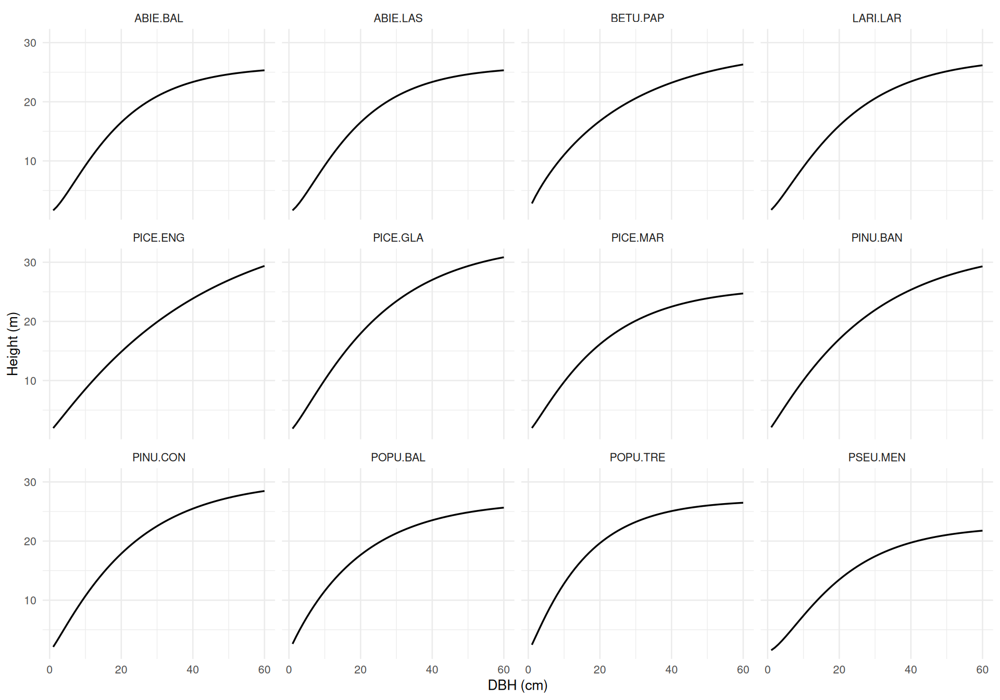

Figure 1

### `hd_huang2016()`

Alberta ([Huang et al., 2016](#ref-Huang2016hd)). Provincial models (no
`natural_subregion`).

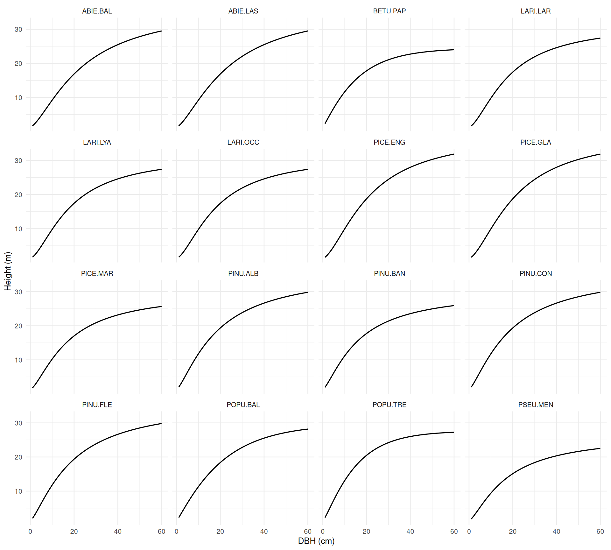

Figure 2

### `hd_huang2016b()`

Alberta ([Huang and Yang, 2016](#ref-Huang2016hdExpanded)). `BA` = 25
m²/ha, several `HDOM` values.

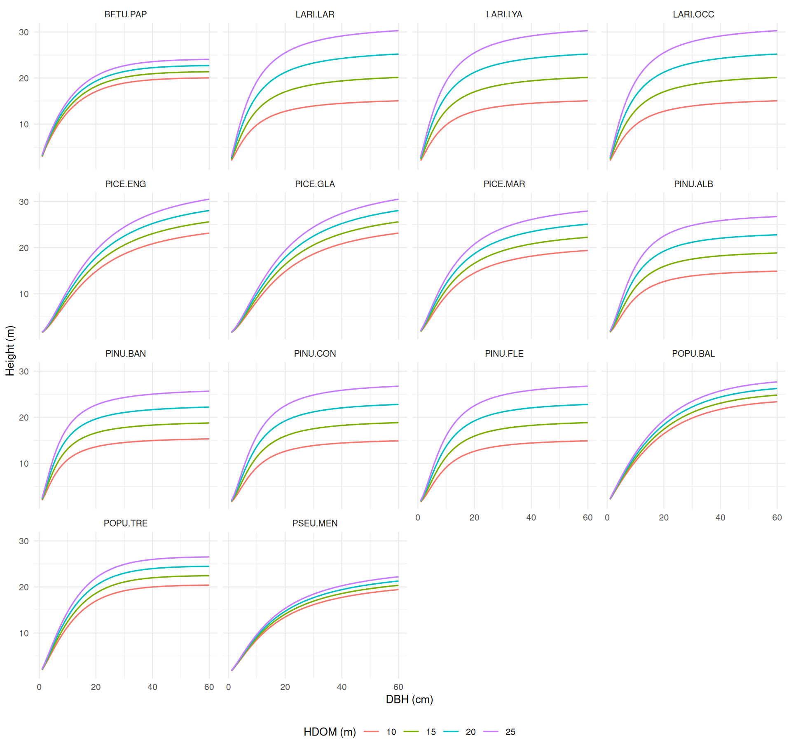

Figure 3

### `hd_sharmaparton2007()`

Northern Ontario ([Sharma and Parton, 2007](#ref-SharmaParton2007)).
`BA` = 25 m²/ha, `TPH` = 2,500 stems/ha, several `HDOM` values.

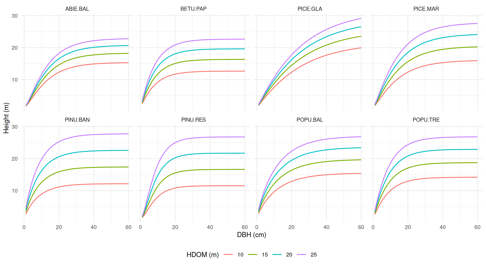

Figure 4

### `hd_sharma2016()`

Ontario ([Sharma, 2016](#ref-Sharma2016)). `HDOM` = 16 m, `BA` = 25
m²/ha, `TPH` = 2,200 stems/ha.

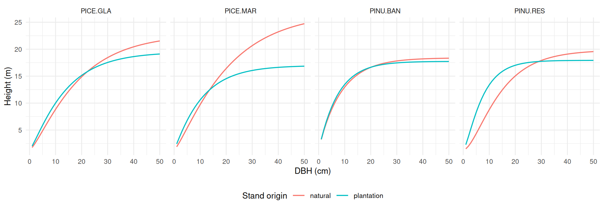

Figure 5

### `hd_sharmazhang2004()`

Northern Ontario ([Sharma and Zhang, 2004](#ref-SharmaZhang2004)). Eq. 2
with `TPH` = 1,500 stems/ha and several `BA` values; eq. 5 (DBH only).

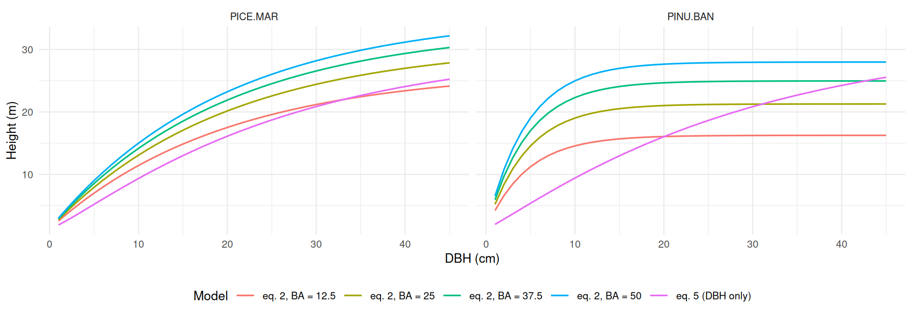

Figure 6

### `hd_eslamdoust2026()`

Ontario ([Eslamdoust et al., 2026](#ref-Eslamdoust2026)). M4 (DBH only)
and M5 with `HDOM` = 20 m, `BA` = 25 m²/ha, `TPH` = 1,500 stems/ha.

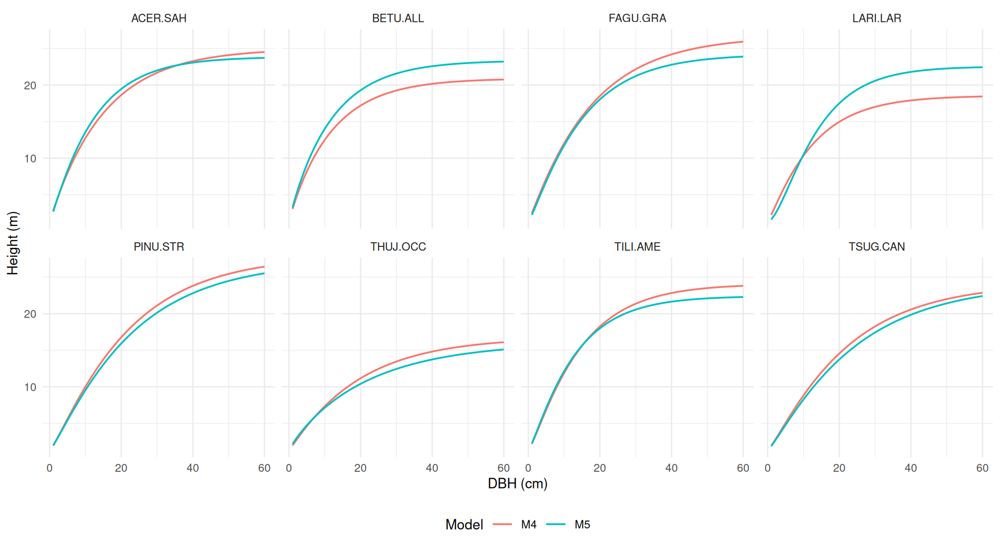

Figure 7

### `hd_eslamdoust2026b()`

Ontario white pine plantations ([Eslamdoust,
2026](#ref-Eslamdoust2026b)), using the TR-79 population model with
`HDOM` = 10, 15, 20 and 25 m, `BA` = 30 m²/ha and `TPH` = 1,500
stems/ha. Curves cover the fitting DBH range (2.9–58.5 cm). This is
separate from the natural-stand model in
[`hd_eslamdoust2026()`](https://ptompalski.github.io/CanadaForestAllometry/reference/hd_eslamdoust2026.md).

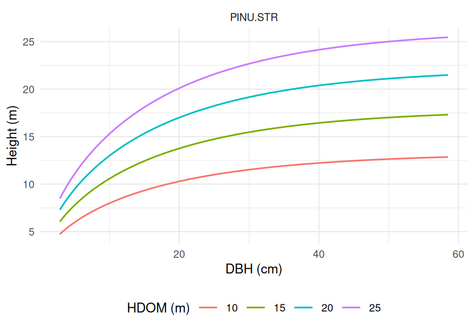

Figure 8

### `hd_huang2009()`

Alberta black spruce ([Huang et al., 2009](#ref-Huang2009hd)). Model 9
(DBH only), 10 (`HTOP` = 16 m) and 11 (`HTOP` = 16 m, `BA` = 15 m²/ha).

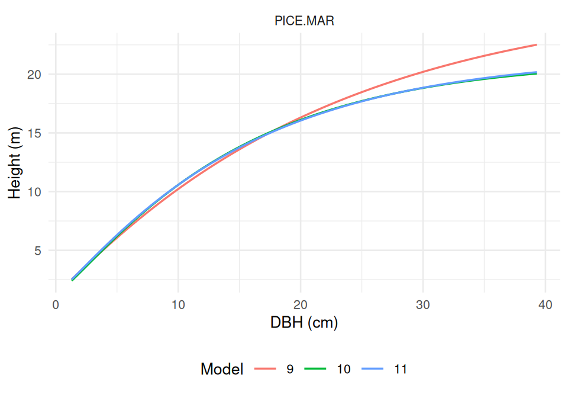

Figure 9

### `hd_zhang2002()`

Ontario jack pine ([Zhang et al., 2002](#ref-Zhang2002hd)). Ecoregion,
forest-region and Ontario-wide fits.

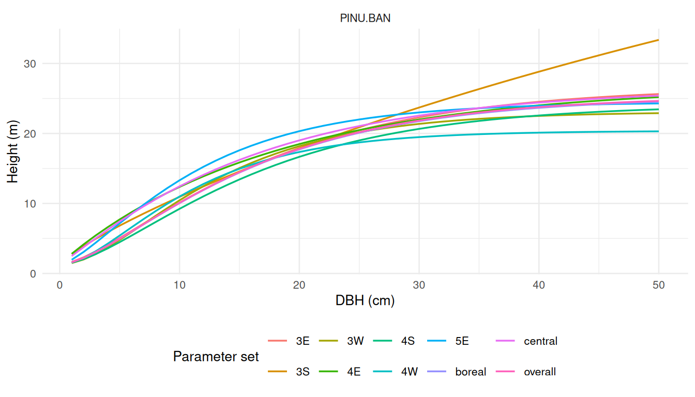

Figure 10

### `hd_temesgen2004()`

Interior British Columbia ([Temesgen and Gadow,
2004](#ref-Temesgen2004)). Model 2 (DBH only) and Model 7 with `BA` = 25
m²/ha, `TPH` = 800 stems/ha, `BAL` = 10 m²/ha.

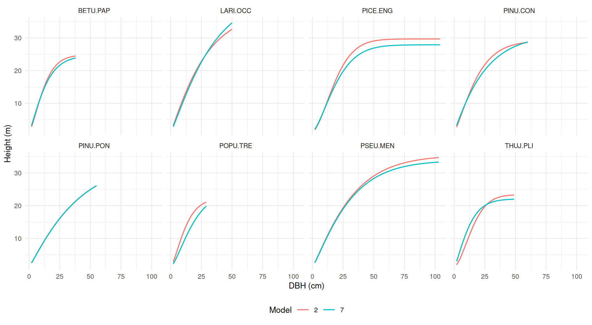

Figure 11

### `hd_staudhammerlemay2000()`

Coastal British Columbia ([Staudhammer and LeMay,
2000](#ref-StaudhammerLeMay2000)). Variant `"dbh"` (one curve per
species) and variant `"density"` for three stands (A, B and C). For the
conifers (eq 2b), stands A–C have `DMAX` = 40, 70 and 100 cm and each
curve runs from 10 % of `DMAX` up to `DMAX`. For red alder (eq 2a),
stands A–C have `TPH` = 1,000, 3,371 and 6,000 stems/ha and `BA` = 15,
30.7 and 50 m²/ha.

Eq 2b predicts height from relative DBH (`DBH / DMAX`). Within a stand,
small trees are suppressed, and the curve drops slightly for the largest
trees, past about 0.85–0.95 of `DMAX`. This drop comes from the
published coefficients.

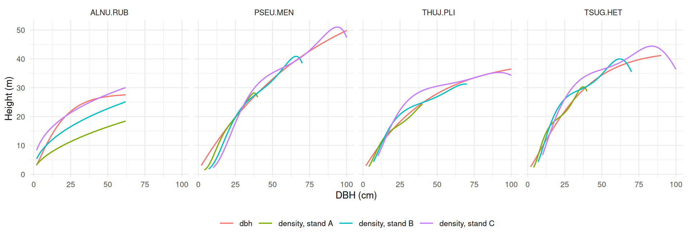

Figure 12

### `hd_rijal2012()`

Acadian Region ([Rijal et al., 2012](#ref-Rijal2012)). GNLS and NLME
coefficients with `BAL` = 10 m²/ha, `CCF` = 150, `CSI` = 15 m.

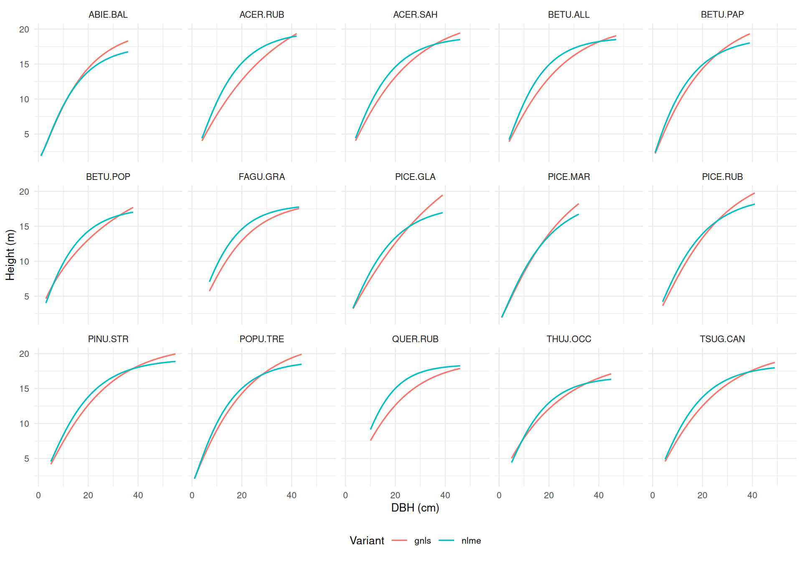

Figure 13

### `hd_auger2016()`

Québec ([Auger, 2016](#ref-Auger2016)). `BA` = 20 m²/ha, `QMD` = 20 cm,
`bioclim_subdomain` = `"4est"`, `physical_env` = `"2"`, `potential_veg`
= `"MS2"`, `MAT` = 2 °C, `MAP` = 1,000 mm, `elevation` = 300 m.

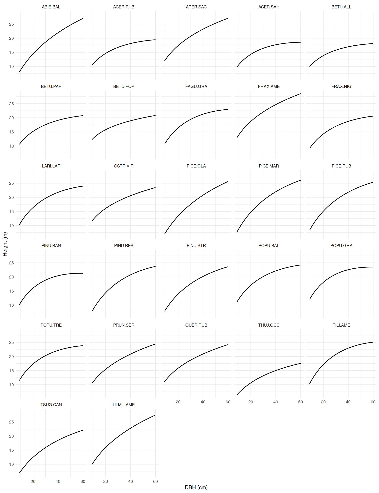

Figure 14

### `hd_fortin2009()`

Québec ([Fortin et al., 2009](#ref-Fortin2009)); superseded by
[`hd_auger2016()`](https://ptompalski.github.io/CanadaForestAllometry/reference/hd_auger2016.md).
`BA` = 20 m²/ha, `QMD` = 20 cm, `ecoregion` = `"4d"`, `drainage` =
`"mesic"`, `MAT` = 2 °C.

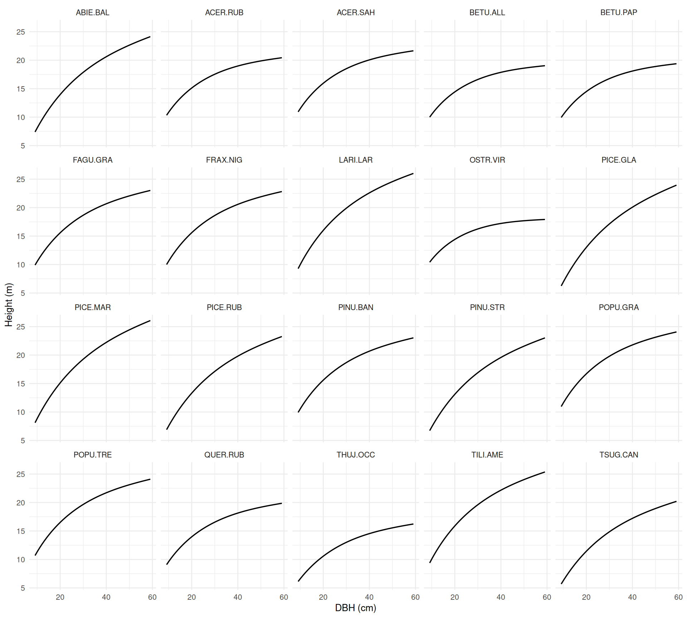

Figure 15

### `hd_auger2025()`

Québec plantations ([Auger et al., 2025](#ref-Auger2025)). The dashed
line is variant `"dbh"`, the population-average curve. It is a Korf
curve with a very large asymptote, so it does not level off within the
data range. The coloured lines are the plot-specific variants for three
plots:

- `"plot_mean_dbh"`: `DMEAN` = 6, 12 and 18 cm.
- `"dominant"`: `HDOM` / `DDOM` = 6 m / 8 cm, 12 m / 16 cm and 18 m / 24
  cm.

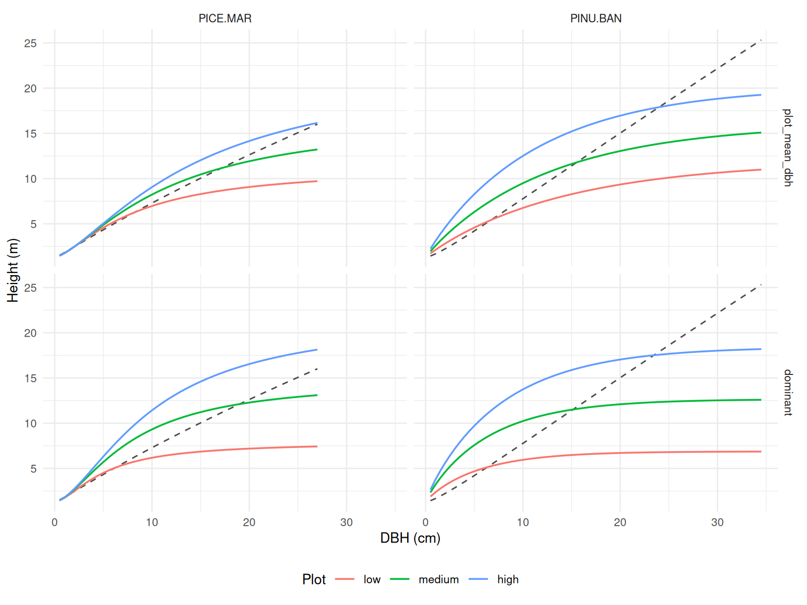

Figure 16

## References

Auger, I., 2016. Une nouvelle relation hauteur-diametre tenant compte de
l’influence de la station et du climat pour 27 essences commerciales du
quebec (Note de recherche forestiere No. 146). Gouvernement du Quebec,
ministere des Forets, de la Faune et des Parcs, Direction de la
recherche forestiere, Quebec.

Auger, I., DeBlois, J., Lambert, M.-C., 2025. Relations
hauteur-diametre, tarifs de cubage et equations de defilement pour
l’epinette noire et le pin gris en plantation au quebec (Avis technique
No. SSS-10). Gouvernement du Quebec, ministere des Ressources naturelles
et des Forets, Direction de la recherche forestiere, Quebec.
<https://doi.org/10.82204/dcwg-5v65>

Eslamdoust, J., 2026. Height–diameter model for white pine plantations
in Ontario (Science and Research Technical Report No. TR-79). Ontario
Ministry of Natural Resources, Science; Research Branch, Peterborough,
ON.

Eslamdoust, J., Vasiliauskas, S., Little, T., Ashiq, M.W., 2026.
Height–diameter modeling of tree species in boreal and mixed forests
using a mixed-effects approach and stand-level variables. Forest Science
and Technology 22, 217–230.
<https://doi.org/10.1080/21580103.2025.2571222>

Fortin, M., Bernier, S., Saucier, J.-P., Labbé, F., 2009. Une relation
hauteur-diametre tenant compte de l’influence de la station et du climat
pour 20 especes commerciales du quebec (Memoire de recherche forestiere
No. 153). Gouvernement du Quebec, ministere des Ressources naturelles et
de la Faune, Direction de la recherche forestiere, Quebec.

Huang, S., Meng, S.X., Yang, Y., 2009. Using nonlinear mixed model
technique to determine the optimal tree height prediction model for
black spruce. Modern Applied Science 3, 3–18.
<https://doi.org/10.5539/mas.v3n4p3>

Huang, S., Titus, S.J., Lakusta, T.W., Held, R.J., 1994. Ecologically
based individual tree height-diameter models for major Alberta tree
species (No. Report \#2, Pub. No. T/291). Alberta Environmental
Protection, Land; Forest Services, Edmonton, Alberta.

Huang, S., Yang, Y., 2016. Expanded individual tree height prediction
models from tree diameter and other variables (No. Report \#5, Tech.
Rep. Pub. No. T/610). Forestry Division, Alberta Agriculture; Forestry,
Edmonton, Alberta.

Huang, S., Yang, Y., Aitkin, D., 2016. Updated population and
plot-specific individual tree height-diameter models for major Alberta
tree species (No. Report \#4, Tech. Rep. Pub. No. T/609). Forestry
Division, Alberta Agriculture; Forestry, Edmonton, Alberta.

Rijal, B., Weiskittel, A.R., Kershaw, Jr., John A., 2012. Development of
regional height to diameter equations for 15 tree species in the North
American Acadian Region. Forestry 85, 379–389.
<https://doi.org/10.1093/forestry/cps036>

Sharma, M., 2016. Comparing height–diameter relationships of boreal tree
species grown in plantations and natural stands. Forest Science 62,
70–77. <https://doi.org/10.5849/forsci.14-232>

Sharma, M., Parton, J., 2007. Height–diameter equations for boreal tree
species in Ontario using a mixed-effects modeling approach. Forest
Ecology and Management 249, 187–198.
<https://doi.org/10.1016/j.foreco.2007.05.006>

Sharma, M., Zhang, S.Y., 2004. Height–diameter models using stand
characteristics for *pinus banksiana* and *picea mariana*. Scandinavian
Journal of Forest Research 19, 442–451.
<https://doi.org/10.1080/02827580410030163>

Staudhammer, C., LeMay, V., 2000. Height prediction equations using
diameter and stand density measures. The Forestry Chronicle 76, 303–309.
<https://doi.org/10.5558/tfc76303-2>

Temesgen, H., Gadow, K. von, 2004. Generalized height–diameter models—an
application for major tree species in complex stands of interior British
Columbia. European Journal of Forest Research 123, 45–51.
<https://doi.org/10.1007/s10342-004-0020-z>

Zhang, L., Peng, C., Huang, S., Zhou, X., 2002. Development and
evaluation of ecoregion-based jack pine height-diameter models for
Ontario. The Forestry Chronicle 78, 530–538.
<https://doi.org/10.5558/tfc78530-4>
