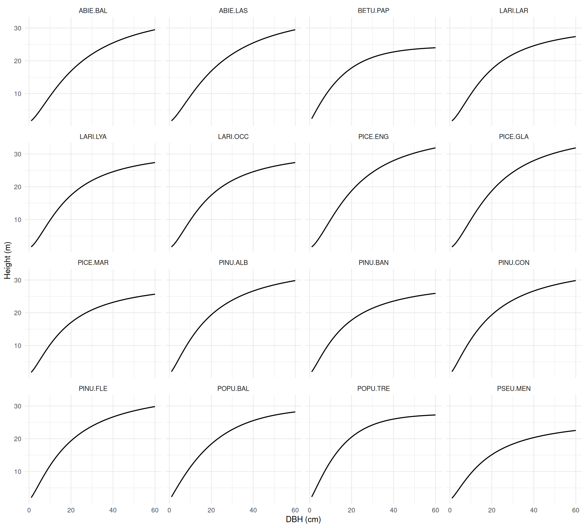
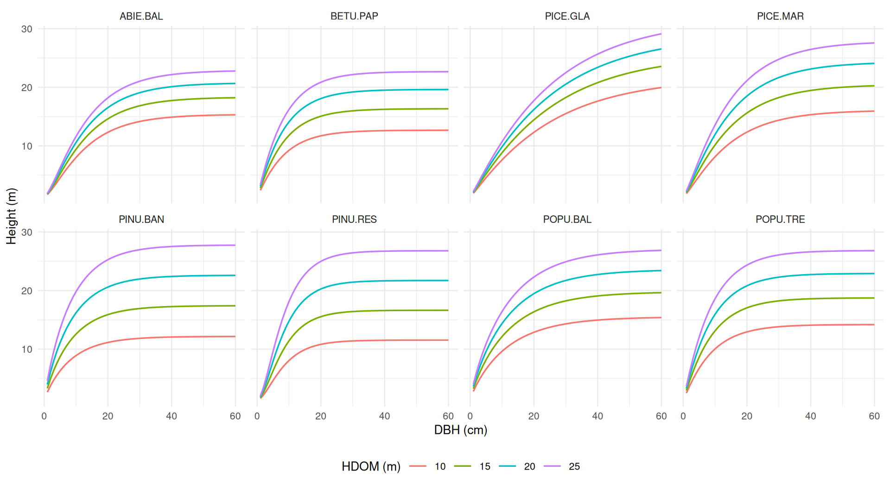
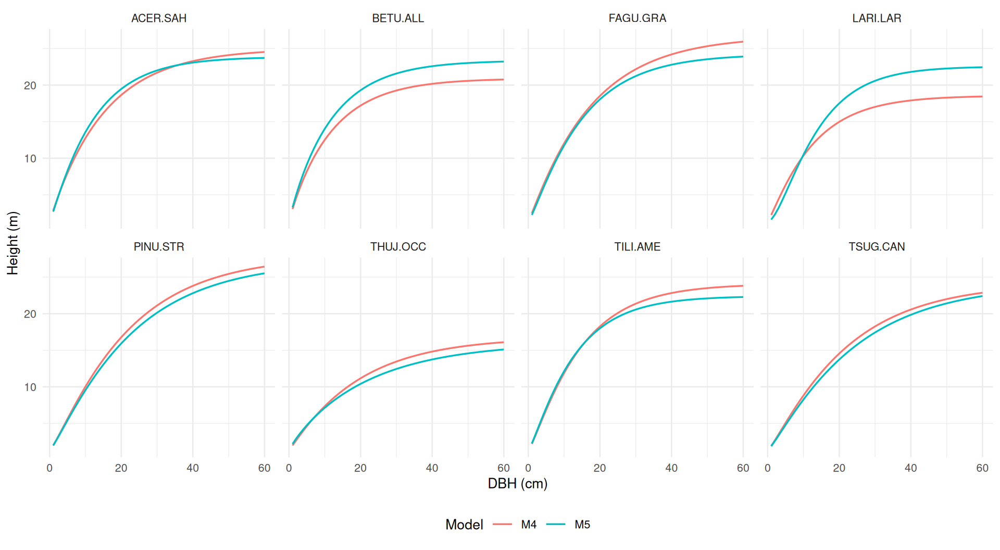
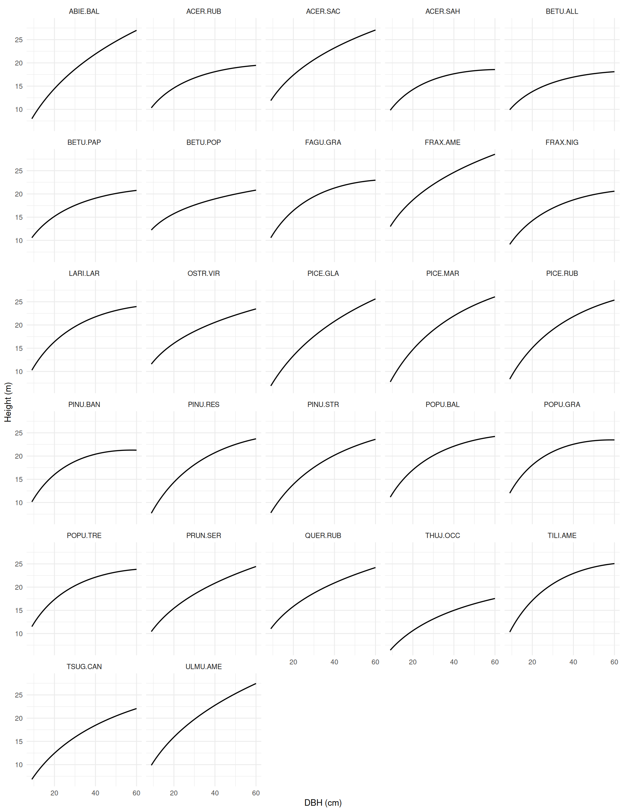
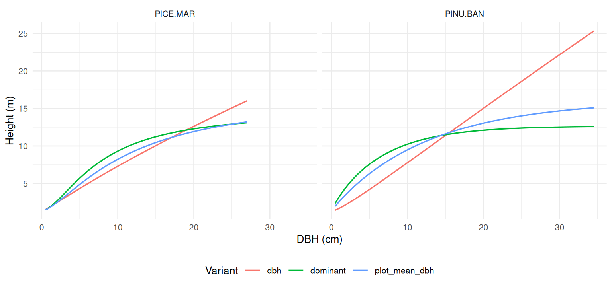

# DBH–Height Models

DBH–height (`hd_*()`) models predict **total tree height (m)** from
diameter at breast height (DBH, cm, measured at 1.3 m). They are
typically used to fill in heights of trees that were not measured,
before applying a volume or biomass model that requires height.

Many published DBH–height models need more than DBH: stand-level
predictors such as basal area, stems per hectare or dominant height,
climate normals, or ecological classification codes. Each source also
defines these predictors differently (size thresholds, all-species vs
species-specific totals, dominant-height definitions). For this reason:

- each model is a separate function whose arguments are exactly the
  predictors that model uses;
- there is **no automatic model selection** (unlike
  [`vol()`](https://ptompalski.github.io/CanadaForestAllometry/reference/vol.md)):
  you choose the model, and a missing required predictor is an error,
  never replaced by a proxy;
- a registry and two helper functions let you find which models suit
  your data, and what each predictor means in the source publication.

## DBH–height models included in the package

- [`hd_auger2016()`](https://ptompalski.github.io/CanadaForestAllometry/reference/hd_auger2016.md)
  ([Auger, 2016](#ref-Auger2016)). Coverage: QC, natural stands. 27
  species. Model ID(s): `auger2016`.
- [`hd_auger2025()`](https://ptompalski.github.io/CanadaForestAllometry/reference/hd_auger2025.md)
  ([Auger et al., 2025](#ref-Auger2025)). Coverage: QC, plantations. 2
  species. Model ID(s): `auger2025_dbh`, `auger2025_plot_mean_dbh`,
  `auger2025_dominant`.
- [`hd_eslamdoust2026()`](https://ptompalski.github.io/CanadaForestAllometry/reference/hd_eslamdoust2026.md)
  ([Eslamdoust et al., 2026](#ref-Eslamdoust2026)). Coverage: ON,
  natural stands. 8 species. Model ID(s): `eslamdoust2026_m4`,
  `eslamdoust2026_m5`.
- [`hd_huang2016()`](https://ptompalski.github.io/CanadaForestAllometry/reference/hd_huang2016.md)
  ([Huang et al., 2016](#ref-Huang2016hd)). Coverage: AB, natural
  stands. 16 species. Model ID(s): `huang2016`.
- [`hd_sharmaparton2007()`](https://ptompalski.github.io/CanadaForestAllometry/reference/hd_sharmaparton2007.md)
  ([Sharma and Parton, 2007](#ref-SharmaParton2007)). Coverage: ON,
  natural stands and plantations. 8 species. Model ID(s):
  `sharmaparton2007`.

The registry has one row per model **variant**. Some functions implement
several variants:
[`hd_eslamdoust2026()`](https://ptompalski.github.io/CanadaForestAllometry/reference/hd_eslamdoust2026.md)
chooses M4 (DBH only) or M5 (with stand variables) from the predictors
you supply, and
[`hd_auger2025()`](https://ptompalski.github.io/CanadaForestAllometry/reference/hd_auger2025.md)
uses an explicit `variant` argument because its variants need different
inputs.

| Model ID | Function | Jurisdiction | Origin | Required predictors | Optional predictors | Species |
|:---|:---|:---|:---|:---|:---|---:|
| `huang2016` | [`hd_huang2016()`](https://ptompalski.github.io/CanadaForestAllometry/reference/hd_huang2016.md) | AB | natural | `DBH` | `natural_subregion` | 16 |
| `sharmaparton2007` | [`hd_sharmaparton2007()`](https://ptompalski.github.io/CanadaForestAllometry/reference/hd_sharmaparton2007.md) | ON | both | `DBH`, `HDOM`, `BA`, `TPH` | — | 8 |
| `eslamdoust2026_m4` | [`hd_eslamdoust2026()`](https://ptompalski.github.io/CanadaForestAllometry/reference/hd_eslamdoust2026.md) | ON | natural | `DBH` | — | 8 |
| `eslamdoust2026_m5` | [`hd_eslamdoust2026()`](https://ptompalski.github.io/CanadaForestAllometry/reference/hd_eslamdoust2026.md) | ON | natural | `DBH`, `HDOM`, `BA`, `TPH` | — | 8 |
| `auger2016` | [`hd_auger2016()`](https://ptompalski.github.io/CanadaForestAllometry/reference/hd_auger2016.md) | QC | natural | `DBH`, `BA` | `QMD`, `SDOM`, `MP`, `VP`, `TMOY`, `PTOT`, `altitude`, `disturbance` | 27 |
| `auger2025_dbh` | [`hd_auger2025()`](https://ptompalski.github.io/CanadaForestAllometry/reference/hd_auger2025.md) | QC | plantation | `DBH` | — | 2 |
| `auger2025_plot_mean_dbh` | [`hd_auger2025()`](https://ptompalski.github.io/CanadaForestAllometry/reference/hd_auger2025.md) | QC | plantation | `DBH`, `mean_DBH` | — | 2 |
| `auger2025_dominant` | [`hd_auger2025()`](https://ptompalski.github.io/CanadaForestAllometry/reference/hd_auger2025.md) | QC | plantation | `DBH`, `HDOM`, `dominant_DBH` | — | 2 |

## Finding a model for your data

[`hd_model_registry()`](https://ptompalski.github.io/CanadaForestAllometry/reference/hd_model_registry.md)
returns the full metadata table (model form, region argument, whether
calibration information is published, etc.):

``` r

hd_model_registry() |>
  dplyr::select(model_id, engine, province_scope, equation_family, required_predictors)
#> # A tibble: 8 × 5
#>   model_id             engine province_scope equation_family required_predictors
#>   <chr>                <chr>  <list>         <chr>           <list>             
#> 1 huang2016            hd_hu… <chr [1]>      chapman_richar… <chr [1]>          
#> 2 sharmaparton2007     hd_sh… <chr [1]>      chapman_richar… <chr [4]>          
#> 3 eslamdoust2026_m4    hd_es… <chr [1]>      chapman_richar… <chr [1]>          
#> 4 eslamdoust2026_m5    hd_es… <chr [1]>      chapman_richar… <chr [4]>          
#> 5 auger2016            hd_au… <chr [1]>      log_quadratic   <chr [2]>          
#> 6 auger2025_dbh        hd_au… <chr [1]>      korf            <chr [1]>          
#> 7 auger2025_plot_mean… hd_au… <chr [1]>      chapman_richar… <chr [2]>          
#> 8 auger2025_dominant   hd_au… <chr [1]>      chapman_richar… <chr [3]>
```

[`find_hd_models()`](https://ptompalski.github.io/CanadaForestAllometry/reference/find_hd_models.md)
filters the registry by jurisdiction and species, and reports which
required predictors each candidate needs that you do not have. Models
with missing predictors are kept as “near misses”, so you can see what
extra data would make them usable:

``` r

find_hd_models(
  jurisdiction = "ON",
  species = "PICE.MAR",
  available = c("DBH", "BA", "TPH")
) |>
  dplyr::select(model_id, usable, missing_predictors)
#> # A tibble: 1 × 3
#>   model_id         usable missing_predictors
#>   <chr>            <lgl>  <list>            
#> 1 sharmaparton2007 FALSE  <chr [1]>
```

Here
[`hd_sharmaparton2007()`](https://ptompalski.github.io/CanadaForestAllometry/reference/hd_sharmaparton2007.md)
covers black spruce in Ontario but also needs dominant height (`HDOM`).
Names in `available` are the `hd_*()` argument names and are
case-sensitive.

[`get_hd_model_info()`](https://ptompalski.github.io/CanadaForestAllometry/reference/get_hd_model_info.md)
returns the registry entry of one model, its species coverage, and its
predictor table:

``` r

info <- get_hd_model_info("sharmaparton2007")
info$species
#> [1] "ABIE.BAL" "BETU.PAP" "PICE.GLA" "PICE.MAR" "PINU.BAN" "PINU.RES" "POPU.BAL"
#> [8] "POPU.TRE"
info$predictors
#> # A tibble: 4 × 6
#>   arg   level units    required definition                        source_locator
#>   <chr> <chr> <chr>    <lgl>    <chr>                             <chr>         
#> 1 DBH   tree  cm       TRUE     D = diameter at breast height (D… FEM 249:187-1…
#> 2 HDOM  plot  m        TRUE     Dominant stand height (SHT): mea… FEM 249:187-1…
#> 3 BA    plot  m2/ha    TRUE     Total tree basal area (BA/ha); m… FEM 249:187-1…
#> 4 TPH   plot  stems/ha TRUE     Number of stems (N/ha), calculat… FEM 249:187-1…
```

## Predictors

Predictor arguments follow a shared vocabulary, with upper-case acronyms
and lower-case words. A shared name is used only when the source’s
quantity fits it; the exact definition (size threshold, species basis,
dominant-height definition) is **model-specific** and is given in each
function’s help page and in the table below.

| Argument | Level | Units | Meaning |
|----|----|----|----|
| `DBH` | tree | cm | Diameter at breast height (1.3 m) |
| `species` | tree | NFI code | Species code, e.g. `PICE.MAR` |
| `BA` | plot | m²/ha | Stand basal area |
| `TPH` | plot | stems/ha | Stand density |
| `HDOM` | plot | m | Dominant (or dominant and codominant) height |
| `QMD` | plot | cm | Quadratic mean DBH |
| region / classification | plot | code | Model-specific names, e.g. `natural_subregion` (AB), `SDOM`, `MP`, `VP` (QC) |

Plot-level predictors can be given as a single value (recycled to all
trees) or as one value per tree. The package does not compute stand
variables from tree lists, because each source defines them differently:
compute `BA`, `TPH`, `HDOM`, etc. following the definition of the model
you use.

Predictor definitions for every implemented model, as given in the
source publication (with page or table):

| Model ID | Argument | Level | Units | Required | Definition | Source |
|:---|:---|:---|:---|:---|:---|:---|
| `huang2016` | `DBH` | tree | cm | yes | Tree diameter (cm) measured at a breast height of 1.3 m above the ground. | T/609 p. 6 (eqs. \[1\]-\[2\]) |
| `huang2016` | `natural_subregion` | plot | code (1-21 or e.g. ‘CM’) | no | Alberta 2006 natural subregion (Natural Regions Committee 2006); selects the natural-subregion-group model. NULL = provincial model. | T/609 Table 2 (p. 2); Table 4 (p. 7) |
| `sharmaparton2007` | `DBH` | tree | cm | yes | D = diameter at breast height (DBH) (cm). | FEM 249:187-198, p. 190 (eq. 6) |
| `sharmaparton2007` | `HDOM` | plot | m | yes | Dominant stand height (SHT): mean height of sampled dominant and codominant trees in a plot, irrespective of species. | FEM 249:187-198, p. 188; p. 190 |
| `sharmaparton2007` | `BA` | plot | m2/ha | yes | Total tree basal area (BA/ha); minimum DBH for the total not stated. | FEM 249:187-198, p. 188; p. 190 |
| `sharmaparton2007` | `TPH` | plot | stems/ha | yes | Number of stems (N/ha), calculated from the trees with DBH greater than or equal to 2.5 cm. | FEM 249:187-198, p. 188 |
| `eslamdoust2026_m4` | `DBH` | tree | cm | yes | DBH_ij is diameter at breast height (cm) of jth tree in ith plot. | FST 22:217-230, p. 220 (eq. 4) |
| `eslamdoust2026_m5` | `DBH` | tree | cm | yes | DBH_ij is diameter at breast height (cm) of jth tree in ith plot. | FST 22:217-230, p. 220 (eq. 5) |
| `eslamdoust2026_m5` | `HDOM` | plot | m | yes | Stand height (SHT): mean height of dominant and co-dominant trees; species basis not stated. | FST 22:217-230, p. 219; Table 5 (p. 225) |
| `eslamdoust2026_m5` | `BA` | plot | m2/ha | yes | Stand basal area (BAH, m2/ha) of the plot; minimum DBH and species basis not stated. | FST 22:217-230, p. 219; p. 220 |
| `eslamdoust2026_m5` | `TPH` | plot | stems/ha | yes | Number of trees per hectare (n/ha) with DBH \>= 2.5 cm of the plot. | FST 22:217-230, p. 220 (eq. 5) |
| `auger2016` | `DBH` | tree | cm | yes | DHP (diamètre à hauteur de poitrine, 1.3 m) de l’arbre (cm). | NRF 146, p. 4 (eq. \[1\]) |
| `auger2016` | `BA` | plot | m2/ha | yes | ST: surface terrière marchande dans la placette (m2/ha; trees with DBH \> 9 cm, all species). | NRF 146, p. 4; Tableau 3 (p. 6) |
| `auger2016` | `QMD` | plot | cm | no | DHP moyen quadratique des arbres de la placette (cm); used as RDHP = DBH / QMD. Required for 21 species. | NRF 146, Tableau 3 (p. 6); Tableau 5 (pp. 10-11) |
| `auger2016` | `SDOM` | plot | code (‘1’, ‘2est’ … ‘6ouest’) | no | Sous-domaine bioclimatique (11 classes). Required for 11 species. | NRF 146, Tableau 3 (p. 6); Annexe 3 |
| `auger2016` | `MP` | plot | code (0-9) | no | Milieu physique (10 classes; MRN 2013). Required for 10 species. | NRF 146, Tableau 3 (p. 6); Annexe 2 |
| `auger2016` | `VP` | plot | code (e.g. ‘RS2’) | no | Végétation potentielle (three-character code). Required for 15 species. | NRF 146, Tableau 3 (p. 6); Annexe 4 |
| `auger2016` | `TMOY` | plot | degC | no | Température annuelle moyenne sur la période 1981-2010 (°C). Required for 7 species. | NRF 146, Tableau 3 (p. 6) |
| `auger2016` | `PTOT` | plot | mm | no | Précipitations totales annuelles sur la période 1981-2010 (mm). Required for 10 species. | NRF 146, Tableau 3 (p. 6) |
| `auger2016` | `altitude` | plot | m | no | Altitude (m). Required for 4 species. | NRF 146, Tableau 3 (p. 6) |
| `auger2016` | `disturbance` | plot | code (anthropique/naturelle/aucune) | no | Occurrence d’une perturbation légère (3 classes): anthropique, naturelle, aucune; English ‘anthropogenic’, ‘natural’, ‘none’ accepted. Required for 5 species. | NRF 146, Tableau 3 (p. 6); Annexe 2 |
| `auger2025_dbh` | `DBH` | tree | cm | yes | Diamètre à hauteur de poitrine (mesuré à 1,3 m, DHP), cm. | SSS-10 p. 2; eq. 10 (p. 11) |
| `auger2025_plot_mean_dbh` | `DBH` | tree | cm | yes | Diamètre à hauteur de poitrine (mesuré à 1,3 m, DHP), cm. | SSS-10 p. 2; eqs. 11-12 (p. 14) |
| `auger2025_plot_mean_dbh` | `mean_DBH` | plot | cm | yes | DMOY: ‘le DHP moyen de tous les arbres de la placette’ (arithmetic mean DBH of all trees in the plot). | SSS-10 eq. 2 (p. 6) |
| `auger2025_dominant` | `DBH` | tree | cm | yes | Diamètre à hauteur de poitrine (mesuré à 1,3 m, DHP), cm. | SSS-10 p. 2; eqs. 13-14 (p. 16) |
| `auger2025_dominant` | `HDOM` | plot | m | yes | HDOM: mean height of the dominant trees of the plot, i.e. ‘les 8 plus hauts arbres plantés faisant partie de l’étage des arbres dominants et bien répartis dans la placette (200 arbres/ha)’ (400 m2 plots). | SSS-10 eq. 3 (p. 7); p. 2 |
| `auger2025_dominant` | `dominant_DBH` | plot | cm | yes | DDOM: mean DBH of the same dominant trees of the plot. | SSS-10 eq. 3 (p. 7); p. 2 |

For
[`hd_auger2016()`](https://ptompalski.github.io/CanadaForestAllometry/reference/hd_auger2016.md),
the optional predictors are required only for the species whose model
uses them; see
[`?hd_auger2016`](https://ptompalski.github.io/CanadaForestAllometry/reference/hd_auger2016.md)
and the source for the per-species predictor sets.

## Using the models

All `hd_*()` functions are vectorized, return a tibble with a `height`
column (m), and can be used directly inside
[`dplyr::mutate()`](https://dplyr.tidyverse.org/reference/mutate.html):

``` r

trees <- tibble::tibble(
  plot = c(1, 1, 1, 2, 2),
  DBH = c(12, 25, 18, 30, 9),
  species = c("PICE.MAR", "PINU.BAN", "POPU.TRE", "PICE.GLA", "ABIE.BAL"),
  HDOM = c(16, 16, 16, 22, 22),
  BA = c(30, 30, 30, 18, 18),
  TPH = c(3000, 3000, 3000, 1200, 1200)
)

trees |>
  dplyr::mutate(hd_sharmaparton2007(DBH, species, HDOM = HDOM, BA = BA, TPH = TPH))
#> # A tibble: 5 × 7
#>    plot   DBH species   HDOM    BA   TPH height
#>   <dbl> <dbl> <chr>    <dbl> <dbl> <dbl>  <dbl>
#> 1     1    12 PICE.MAR    16    30  3000  12.0 
#> 2     1    25 PINU.BAN    16    30  3000  17.5 
#> 3     1    18 POPU.TRE    16    30  3000  17.3 
#> 4     2    30 PICE.GLA    22    18  1200  21.0 
#> 5     2     9 ABIE.BAL    22    18  1200   9.77
```

A model using DBH only:

``` r

trees |>
  dplyr::mutate(hd_huang2016(DBH, species))
#> # A tibble: 5 × 7
#>    plot   DBH species   HDOM    BA   TPH height
#>   <dbl> <dbl> <chr>    <dbl> <dbl> <dbl>  <dbl>
#> 1     1    12 PICE.MAR    16    30  3000  11.9 
#> 2     1    25 PINU.BAN    16    30  3000  19.8 
#> 3     1    18 POPU.TRE    16    30  3000  19.4 
#> 4     2    30 PICE.GLA    22    18  1200  24.4 
#> 5     2     9 ABIE.BAL    22    18  1200   8.33
```

### Variants

When a source defines a hierarchy of models, the variant is chosen from
the inputs you supply and reported once per session with a message. For
example,
[`hd_huang2016()`](https://ptompalski.github.io/CanadaForestAllometry/reference/hd_huang2016.md)
uses the provincial models unless `natural_subregion` is given, and
[`hd_eslamdoust2026()`](https://ptompalski.github.io/CanadaForestAllometry/reference/hd_eslamdoust2026.md)
uses M5 only when `HDOM`, `BA` and `TPH` are all supplied (supplying
only some of them is an error). Set `keep_model_id = TRUE` to return the
variant used for each tree:

``` r

hd_eslamdoust2026(
  DBH = c(15, 30),
  species = c("ACER.SAH", "PINU.STR"),
  HDOM = 22, BA = 30, TPH = 1200,
  keep_model_id = TRUE
)
#> hd_eslamdoust2026(): `HDOM`, `BA` and `TPH` supplied; using model M5 (DBH and
#> stand variables).
#> This message is displayed once per session.
#> # A tibble: 2 × 2
#>   height model_id         
#>    <dbl> <chr>            
#> 1   17.5 eslamdoust2026_m5
#> 2   21.5 eslamdoust2026_m5
```

When variants need different inputs, the variant is chosen explicitly:

``` r

hd_auger2025(
  DBH = c(6, 9, 12),
  species = "PICE.MAR",
  variant = "dominant",
  HDOM = 9, dominant_DBH = 11
)
#> # A tibble: 3 × 1
#>   height
#>    <dbl>
#> 1   6.15
#> 2   7.73
#> 3   8.70
```

### Missing values and applicability limits

Rows with `NA` in a required input return `NA` height (no error), so the
functions can be applied to tree lists with incomplete data. Inputs
outside the range of the source’s fitting data are still computed, and a
single warning lists the affected rows:

``` r

hd_sharmaparton2007(
  DBH = c(20, NA, 80),
  species = "PICE.MAR",
  HDOM = 20, BA = 25, TPH = 2500
)
#> Warning: `hd_sharmaparton2007()`: 1 row outside the source's published applicability
#> range; predictions are extrapolated.
#> • `DBH`: 1 row (3)
#> # A tibble: 3 × 1
#>   height
#>    <dbl>
#> 1   18.5
#> 2   NA  
#> 3   24.3
```

## Population-level vs calibrated prediction

Most DBH–height models are fitted as mixed-effects models with
plot-level random effects. The `hd_*()` functions return
**population-level** predictions: the fixed effects recommended by the
source for trees in plots without height measurements, with random
effects set to zero. For nonlinear mixed models this is the curve of a
“typical” plot with the supplied predictors, not the mean over plots.

If some trees in a plot have measured heights, a model can be
**calibrated** to that plot by predicting its random effects from the
measured heights. This usually improves predictions considerably, but it
is not implemented yet. The `calibration_published` column of
[`hd_model_registry()`](https://ptompalski.github.io/CanadaForestAllometry/reference/hd_model_registry.md)
indicates whether the source publishes the variance components needed
for it:

``` r

hd_model_registry() |>
  dplyr::select(model_id, prediction_types, calibration_published)
#> # A tibble: 8 × 3
#>   model_id                prediction_types calibration_published
#>   <chr>                   <list>           <lgl>                
#> 1 huang2016               <chr [1]>        TRUE                 
#> 2 sharmaparton2007        <chr [1]>        TRUE                 
#> 3 eslamdoust2026_m4       <chr [1]>        TRUE                 
#> 4 eslamdoust2026_m5       <chr [1]>        TRUE                 
#> 5 auger2016               <chr [1]>        TRUE                 
#> 6 auger2025_dbh           <chr [1]>        FALSE                
#> 7 auger2025_plot_mean_dbh <chr [1]>        FALSE                
#> 8 auger2025_dominant      <chr [1]>        FALSE
```

## Model curves

The figures below show population-level DBH–height curves for each model
and species. For models with stand-level predictors, curves are shown
for the reference plot values stated with each figure; heights for other
plots can differ substantially. Curves are drawn over a common DBH range
and may extend beyond the fitting data of a species.

### `hd_huang2016()`

Alberta ([Huang et al., 2016](#ref-Huang2016hd)). Provincial models (no
`natural_subregion`).



Figure 1

### `hd_sharmaparton2007()`

Northern Ontario boreal ([Sharma and Parton,
2007](#ref-SharmaParton2007)). `BA` = 25 m²/ha and `TPH` = 2,500
stems/ha, for several dominant heights (`HDOM`), as in Fig. 2 of the
source.



Figure 2

### `hd_eslamdoust2026()`

Ontario boreal and Great Lakes–St. Lawrence forests ([Eslamdoust et al.,
2026](#ref-Eslamdoust2026)). M4 (DBH only) and M5 with `HDOM` = 20 m,
`BA` = 25 m²/ha and `TPH` = 1,500 stems/ha.



Figure 3

### `hd_auger2016()`

Québec, 27 species ([Auger, 2016](#ref-Auger2016)). Reference plot: `BA`
= 20 m²/ha, `QMD` = 20 cm, `SDOM` = `"4est"`, `MP` = `"2"`, `VP` =
`"MS2"`, `TMOY` = 2 °C, `PTOT` = 1,000 mm, `altitude` = 300 m,
`disturbance` = `"none"` (each species uses only the predictors in its
model). The source advises against use for trees with DBH \< 9 cm, so
curves start at 9 cm.



Figure 4

### `hd_auger2025()`

Québec black spruce and jack pine **plantations** ([Auger et al.,
2025](#ref-Auger2025)). The three variants: DBH only, plot mean DBH
(`mean_DBH` = 12 cm), and dominant height and DBH (`HDOM` = 12 m,
`dominant_DBH` = 16 cm). Curves are limited to the calibration DBH range
of each species.



Figure 5

## References

Auger, I., 2016. Une nouvelle relation hauteur-diametre tenant compte de
l’influence de la station et du climat pour 27 essences commerciales du
quebec (Note de recherche forestiere No. 146). Gouvernement du Quebec,
ministere des Forets, de la Faune et des Parcs, Direction de la
recherche forestiere, Quebec.

Auger, I., DeBlois, J., Lambert, M.-C., 2025. Relations
hauteur-diametre, tarifs de cubage et equations de defilement pour
l’epinette noire et le pin gris en plantation au quebec (Avis technique
No. SSS-10). Gouvernement du Quebec, ministere des Ressources naturelles
et des Forets, Direction de la recherche forestiere, Quebec.
<https://doi.org/10.82204/dcwg-5v65>

Eslamdoust, J., Vasiliauskas, S., Little, T., Ashiq, M.W., 2026.
Height–diameter modeling of tree species in boreal and mixed forests
using a mixed-effects approach and stand-level variables. Forest Science
and Technology 22, 217–230.
<https://doi.org/10.1080/21580103.2025.2571222>

Huang, S., Yang, Y., Aitkin, D., 2016. Updated population and
plot-specific individual tree height-diameter models for major Alberta
tree species (No. Report \#4, Tech. Rep. Pub. No. T/609). Forestry
Division, Alberta Agriculture; Forestry, Edmonton, Alberta.

Sharma, M., Parton, J., 2007. Height–diameter equations for boreal tree
species in Ontario using a mixed-effects modeling approach. Forest
Ecology and Management 249, 187–198.
<https://doi.org/10.1016/j.foreco.2007.05.006>
