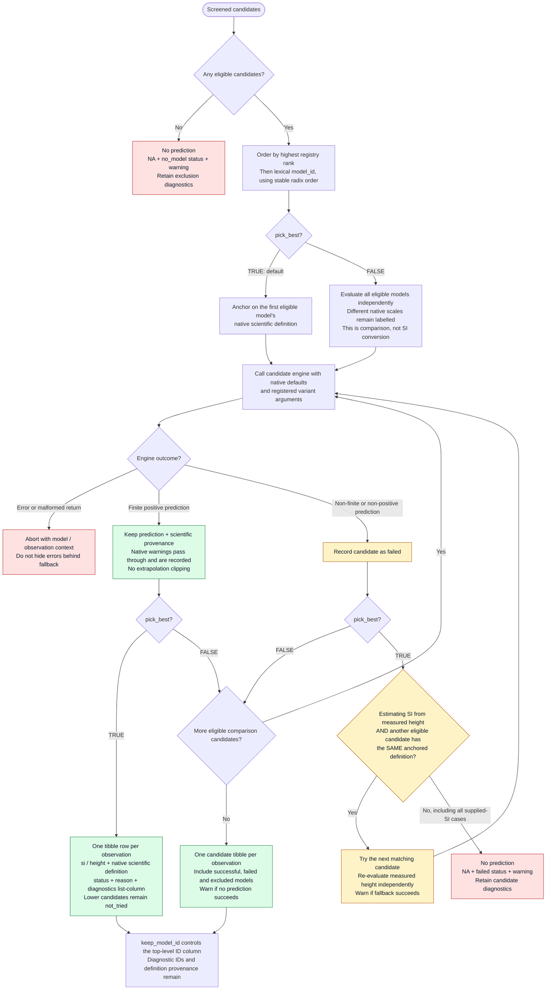
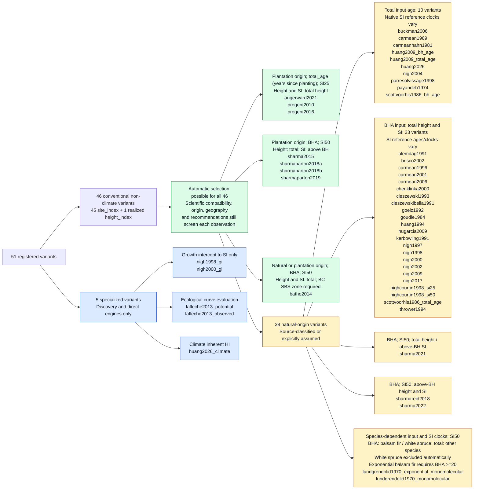

# How `si()` selects a model

These diagrams describe the implemented dispatcher in [R/si.R](R/si.R), not a
proposed selection policy. Mermaid diagrams render on GitHub and in
Mermaid-enabled Markdown previews.

**Current implementation:** all **46 conventional variants** have resolved
scientific contracts and can participate in automatic selection for compatible
observations. The previous unknown-origin and unresolved-definition groups are
gone. Models not identified as plantation or mixed-origin now default to
**assumed natural origin**, with the assumption retained in evidence.
The **five specialized variants** remain outside `si()`.

**The key rule:** scientific compatibility comes before rank. Input age and
the SI reference have independent clocks. The wrapper does not convert clocks,
change reference ages, add height offsets or make one model's SI interchangeable
with another's.

## 1. Inputs and candidate screening

Selection is repeated independently for each observation after common-length
recycling. A fixed `model_id` prevents observation-wise switching between models.

```mermaid
flowchart TD
    start(["Call si()"]) --> valid{"Valid types, choices, lengths,<br/>positive finite numeric values,<br/>and exactly one of height / si?"}
    valid -->|No| error["Abort with an explicit error"]
    valid -->|Yes| idcheck{"Explicit model IDs valid<br/>and conventional?"}
    idcheck -->|No: unknown or specialized| error
    idcheck -->|Yes, or no ID supplied| direction{"Which input is supplied?"}

    direction -->|Measured height| infer["Estimate SI<br/>Native scale allowed;<br/>requested definition fields are filters"]
    direction -->|Supplied SI| declaration{"Originating model_id supplied?"}
    declaration -->|Yes| native["ID declares that model's native SI<br/>Additional requests must still match"]
    declaration -->|No| full{"All four SI fields supplied?<br/>reference_age, reference_age_basis,<br/>si_datum, productivity_quantity"}
    full -->|No| error
    full -->|Yes| unpinned["Warn: matching labels do not<br/>prove SI interchangeability<br/>No fallback for supplied SI"]

    infer --> rows
    native --> rows
    unpinned --> rows
    rows["For each observation"] --> missing{"Required observation values missing?<br/>age, height / si, species, jurisdiction,<br/>input_age_basis, height_datum"}
    missing -->|Yes| na["Return NA + missing_input status<br/>and a summary warning"]
    missing -->|No| pinned{"Explicit model_id for this row?"}
    pinned -->|Yes| one["Screen only that registered model"]
    pinned -->|No| scope["Find registered species + jurisdiction matches<br/>Exact species match; no genus fallback"]

    one --> science
    scope --> science
    science["Screen every candidate:<br/>1. Conventional non-climate family<br/>2. Registered species / jurisdiction<br/>3. Unambiguous native SI definition<br/>4. Input clock + height datum match<br/>5. Requested SI fields match<br/>6. No unresolved claims for these definitions"]
    science --> pass{"All scientific checks pass?"}
    pass -->|No| excluded["Keep candidate as excluded<br/>Record incompatibility / uncertainty reasons"]
    pass -->|Yes| applicability{"Origin and encoded geography<br/>are compatible and known?"}
    applicability -->|Known mismatch| excluded
    applicability -->|Unknown, automatic selection| excluded
    applicability -->|Unknown, explicit ID| review["Permit source-reviewed explicit use<br/>Warn if attempted; retain limitations"]
    applicability -->|Known match| optional
    review --> optional
    optional["Check supplied discrete optional inputs<br/>Forward supported regional arguments;<br/>otherwise use native defaults"]
    optional --> supported{"Supported inputs?"}
    supported -->|No| excluded
    supported -->|Yes| recommendation{"Published recommendation violated?<br/>Lundgren-Dolid white spruce;<br/>exponential balsam fir below BHA20"}
    recommendation -->|Yes, automatic selection| excluded
    recommendation -->|Yes, explicit ID| cautionuse["Permit explicit use with warning<br/>Retain source recommendation limitation"]
    recommendation -->|No| eligible["Eligible candidate"]
    cautionuse --> eligible
    eligible --> execution["Continue to execution diagram"]
    excluded -.-> diagnostics["Exclusions remain in candidate diagnostics;<br/>other candidates may still qualify"]

    classDef stop fill:#fee2e2,stroke:#b91c1c,color:#111827;
    classDef caution fill:#fef3c7,stroke:#b45309,color:#111827;
    classDef good fill:#dcfce7,stroke:#15803d,color:#111827;
    class error,excluded,na stop;
    class unpinned,review,cautionuse,diagnostics caution;
    class eligible good;
```

Scientific requests use `reference_age`, `reference_age_basis`,
`productivity_quantity` and `si_datum`. An omitted field means the model's native
value when estimating SI. `input_age_basis` is always required; `height_datum`
defaults to total height and remains independent of SI datum.

Encoded BC geography checks include coast/interior and SBS/ESSF restrictions.
Free-text stand composition, structure, local geography and height sampling
still need source review; passing these checks is not universal ecological
validation.
Observation origin must still be supplied for automatic selection. The natural-
origin default applies to model applicability, not to missing observations.

## 2. Execution, fallback and output

Fallback requires the same **input clock, reference age, reference clock,
productivity quantity, SI datum, height datum and reference-age role** as the
anchor. Identical labels still do not establish cross-model SI interchangeability:
fallback estimates SI afresh from measured height; it never transfers an SI
value between engines.

Comparison mode can evaluate supplied SI under multiple models only as an
explicitly warned, unpinned comparison. Use its originating `model_id` for a
reproducible height trajectory.

## 3. Current routes for every registered model

All **51 registered variants** appear below exactly once. These are current
metadata-dependent routes, not rankings or claims that a model is intrinsically
more suitable. "Automatic possible" assumes matching species, jurisdiction,
native height datum, origin and required regional information; it does not mean
the model is eligible for every observation.

Important details behind this map:

- **BHA** means breast-height age. Height and SI datums in the automatic
  branches are the native wrapper settings, not optional direct-engine modes.
- The three models using years since planting are classified as `total_age`,
  without a nursery-age adjustment, and use native SI25. Registry SI50 plotting
  overrides do not change dispatch.
- The automatic breast-height-age group does **not** share one height/SI datum:
  Sharma/Parton SI is above breast height; `sharma2022` and `sharmareid2018` require
  `height_datum = "above_breast_height"`. Batho requires the SBS zone and supports
  natural or plantation origin.
- `sharmareid2018` uses natural-origin jack pine/black spruce, BHA50 and
  above-BH height/SI, explicitly supported by Figure 2 (p. 38). Both
  automatic and explicit dispatch require the above-BH height datum;
  no 1.3 m offset is applied and Carmean's native SI is not substituted.
- `huang2009_bh_age` still takes **total input age**, despite its ID. Its native
  SI reference is breast-height age. `huang2026` returns non-climate realized HI,
  not conventional SI or climate inherent HI.
- `payandeh1974` uses total input/reference age with species-specific
  SI50/80/100. Balsam fir and white spruce clocks are explicit assumptions,
  not publication-verified; Douglas-fir retains an exact-edition caveat.
  These disclosed gaps do not block the approved total-age contract.
- Natural-origin assumptions are not publication verification, and do not
  expand geographic, stand-structure or sampling applicability. Known plantation
  and mixed-origin classifications are preserved. No plantation/natural fallback
  or inference of missing observation origin is performed.
- An explicit ID still pins a model and its native scale. It can permit
  disclosed geographic uncertainty or a published recommendation violation
  with a warning; it cannot override a clock, datum or known origin/geography
  mismatch.

## 4. Implemented source reconciliations and remaining limits

The seven previously blocked conventional variants are now reconciled in code.

| Model IDs | Native contract | Implemented treatment |
|---|---|---|
| `scottvoorhis1986_bh_age`, `scottvoorhis1986_total_age` | SI50 uses total age. The legacy `bh_age` ID takes total input age (`FALSE`); the legacy `total_age` ID takes BHA (`TRUE`, source YTBH added internally). | Corrected scientific labels and docs; IDs, selectors and equations retained. Do not infer input clocks from suffixes. |
| `lundgrendolid1970_exponential_monomolecular`, `lundgrendolid1970_monomolecular` | Balsam fir/white spruce use BHA; the other nine species use total age. SI50 uses the corresponding clock. | Species-specific definitions; white spruce excluded automatically; exponential balsam fir excluded automatically below BHA20. Explicit recommendation violations warn. |
| `parresolvissage1998` | Total input/reference age; native SI50, total height. | Corrected docs and verified clock evidence; native minimum ages of 10 unchanged. |
| `nigh2004` | Juvenile total-age observations; GI-derived total-height SI50 at BHA50. | Independent clocks and GI provenance encoded. Not a mature trajectory or exact base-age identity. |
| `nighcourtin1998_si50` | Equation 7 publishes the implemented total-height SI25-to-SI50 conversion. | Verified provenance; rounded conversion and `converted_index` role retained. |

The detailed publication evidence and implementation handoffs are in
[si_improvements_plan.md](si_improvements_plan.md). Uncertainty that remains
visible includes assumed natural origins, the approved Payandeh clock
assumptions/edition gap and incompletely encoded population/sampling limits.

The five specialized variants remain outside `si()` for a separate reason:
GI input, ecological IQS and climate inherent HI are different operations or
quantities. Resolving their metadata does not enable conventional dispatch.
The observed Lafleche family's source clock remains unresolved within that
specialized group.

## 5. Options at a glance

| Input / option | Effect on selection |
|---|---|
| `age` + exactly one of `height` / `si` | Chooses SI estimation or height prediction. |
| `species`, `jurisdiction` | Restrict registered coverage; no species genus fallback. |
| `input_age_basis` | Required observation clock; must match, without conversion. |
| `reference_age`, `reference_age_basis` | Filter native SI reference definitions; do not set `base_age`. |
| `si_datum`, `productivity_quantity` | Filter SI scale/quantity; no offsets or quantity substitution. |
| `height_datum` | Measured/predicted height datum, independently of SI; defaults to total height. |
| `stand_origin` | Observation origin required for automatic selection; match source-classified or explicitly assumed model origin. No natural/plantation fallback. |
| `bec_zone` | Checks encoded BC restrictions; explicitly selects supplied-zone modes where accepted. |
| `natural_subregion` in `...` | Passed only to accepting engines; unsupported discrete values are excluded where encoded. |
| `model_id` | Pins a conventional model/variant; declares its native SI when SI is supplied. |
| `pick_best = TRUE` / `FALSE` | One preferred result versus per-observation candidate comparisons. |
| `keep_model_id` | Controls the result ID column, not scientific provenance or eligibility. |
| `base_age`, `total_height`, `variant`, other definition selectors in `...` | Rejected by the wrapper; use a registered variant or the direct engine. |

Use `find_si_models()` to browse coverage, scientific near-misses and name-level
input requirements without running engines. Use `get_si_model_info(model_id)`
to inspect source definitions, applicability, native defaults, constraints and
unresolved evidence before interpreting a model's SI.
